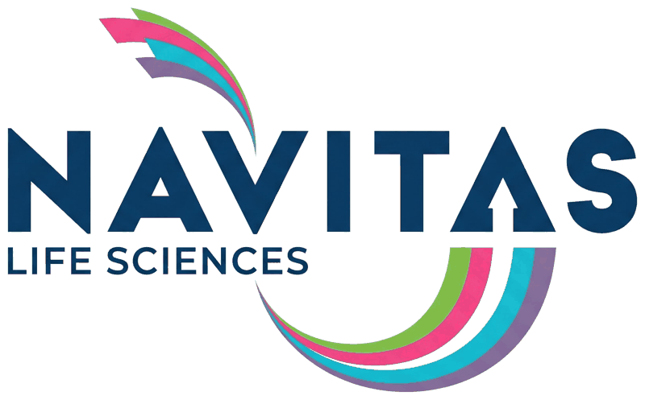
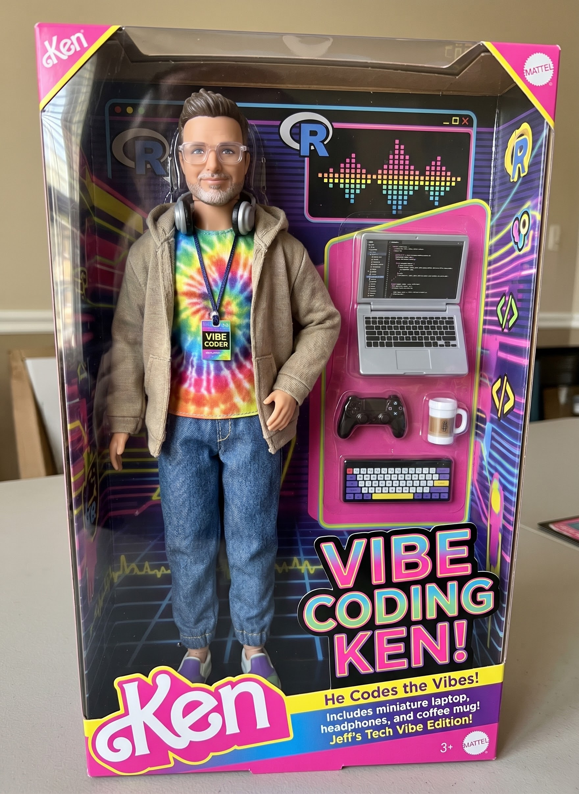

# Welcome {.unnumbered}

## Harness engineering

**Make AI output reliable and traceable**

BBSW 2026 Day 0 Hands-on Workshop &middot; Nov 4, 2026 &middot; Genentech Campus

Jeff Dickinson, PhD — Navitas Data Sciences

{.nostretch fig-alt="Navitas Life Sciences logo" width="240"}

::: {.notes}
Slot: 0:55–1:25 (30 min), after Philip's build/agentic-coding fundamentals.
Later: 2:05–3:00 integration sprint, shared with Philip.

Everything today is prompt-driven. Each exercise slide has a box you copy and
paste into the AI agent. Attendees are in the preconfigured Posit environment.
:::

## Meet Vibe Coding Ken

:::: {.columns}
::: {.column width="40%"}
{fig-alt="A Ken doll in a box labeled Vibe Coding Ken, wearing a tie-dye shirt, hoodie, headphones and a VIBE CODER badge, with a miniature laptop, keyboard, game controller and coffee mug" height="540"}
:::

::: {.column width="60%"}
**He codes the vibes.**

- Prompt in, plausible code out
- Prototype in minutes
- No spec, no checks, no review

Great for exploring. But would you hand Ken's ADVS to a reviewer?

**Today: from vibe coding to a harness you can trust.**
:::
::::

::: {.notes}
Icebreaker. Vibe coding is not the enemy — it's how most of us start with an
agent. The question for biometrics is what you add around it so the output can
be traced and reviewed. That's the rest of this block.
:::

## Get the slides and prompts

:::: {.columns}
::: {.column width="24%"}
::: {style="text-align: center"}
{.nostretch fig-alt="QR code linking to the slides at jeffreyad.github.io/bbsw-2026-harness-workshop" width="250"}

**Slides**
:::
:::

::: {.column width="24%"}
::: {style="text-align: center"}
{.nostretch fig-alt="QR code linking to github.com/jeffreyad/bbsw-2026-harness-workshop" width="250"}

**Repo & prompts**
:::
:::

::: {.column width="52%"}
::: {style="font-size: 0.8em"}
[jeffreyad.github.io/\
bbsw-2026-harness-workshop](https://jeffreyad.github.io/bbsw-2026-harness-workshop/)

- `prompts.md` — every prompt, ready to copy
- `fallback/SPEC.md` — ready-made ADVS spec

Paste into **Posit Assistant** (Claude Code works too).

**Core:** 1, 2, 3, 5 · **Stretch:** 4, 6 · **Sprint:** 7
:::
:::
::::

::: {.notes}
Leave this up while people open the environment. Anyone who falls behind can
copy from prompts.md rather than retyping from the screen.
:::

## The idea in one slide

> **Agent = model + harness**

The model is the same for everyone. What differs is everything around it:

- **Specs** — what "correct" means, written down before any code
- **Checks** — automated tests that tell the agent (and you) when it is wrong
- **Skills** — reusable instructions the agent loads for a class of task

A good harness turns "plausible-looking output" into "output I can trust and
trace."

::: {.notes}
Vibe coding gets you a prototype in minutes. Harness engineering is what lets
you put it in front of a reviewer. In biometrics the cost of a plausible but
wrong derivation is high, so the harness is not optional.
:::

## Today's loop

1. **Spec** — write the requirement
2. **Generate** — the agent writes code from the spec
3. **Check** — run the checks, read the failures
4. **Refine** — fix the spec, the checks, or the code
5. **Trace** — every output points back to a spec line

Each step is a **prompt** you paste. You review at every step.

::: {.notes}
Philip covers automating this loop (MCP, ellmer) in the next block. Here we do
it by hand so you know what you are automating.
:::

# Part 1 — Specs {.unnumbered}

## Prompt 1 — Spec: let the agent interview you

A spec is a short file the agent reads before writing code. Do not write it
cold — have the agent ask you questions.

``` {.default code-line-numbers="false"}
I want to derive ADVS from the VS domain in data/sdtm and the ADSL in
data/adam/adsl.parquet. Work in a new subfolder called harness/.

Do not write any code yet. Interview me, one question at a time, about
anything ambiguous: baseline definition, parameters, visit windows, flags.
Ask at most 5 questions. When I say "done" (or after question 5), write
harness/SPEC.md with a table of variables:
name, label, derivation rule, source, and open questions.
```

Answer the questions. Then **read** `harness/SPEC.md` and edit anything wrong.

Interview went sideways? Copy `fallback/SPEC.md` into `harness/`.

::: {.notes}
The point: the spec is where human judgment goes. The agent should surface
decisions (baseline rule, population flag) rather than guess them.

The 5-question cap keeps this inside the time slot. fallback/SPEC.md has the
decisions already made (baseline = last non-missing on or before TRTSDT, CHG NA
on baseline, SAFFL = "Y" only) plus three open questions to discuss.

Watch for people accepting the first draft. Ask them to find one rule in
SPEC.md they would have decided differently.
:::

## What a good spec contains

- One row per variable: name, label, **derivation rule**, source
- Explicit decisions — baseline rule, imputation, population
- **Open questions** the agent could not resolve
- Nothing the agent invented silently

If you can't point to the spec line that justifies a line of code, the output
isn't traceable.

## Example: the fallback spec {.smaller}

Two rows from `fallback/SPEC.md`:

- **ABLFL** — "Y" on the last non-missing AVAL on or before TRTSDT, per
  subject and PARAMCD; otherwise NA
- **CHG** — AVAL - BASE on post-baseline records; NA on baseline records

**Decisions made:** baseline = last non-missing on or before TRTSDT ·
CHG is NA (not 0) on baseline · SAFFL = "Y" only

**Open questions** the agent should *not* answer for you:

- How should unscheduled visits be handled for baseline and windowing?
- Are visit windows required, or is the collected VISIT used as is?
- Should records with a missing ADT be dropped or kept with a flag?

# Part 2 — Checks {.unnumbered}

## Prompts 2–3 — Checks: tell the agent when it's wrong

Agents iterate well against a failing test. Give it one.

``` {.default code-line-numbers="false"}
Read harness/SPEC.md. Before deriving anything, write harness/checks.R:
a set of stopifnot() assertions that encode every testable rule in the
spec (one row per record key, flags are "Y" or NA, baseline and change
rules, etc.). Do not write the derivation yet. Show me the checks and tell me which
spec rules you could NOT turn into a check.
```

Then:

``` {.default code-line-numbers="false"}
Now write harness/derive_advs.R from harness/SPEC.md. Run it, then run
harness/checks.R. If a check fails, fix the code first and tell me what
you changed. If you believe the check itself is wrong, stop and tell me
why instead of editing it.
```

::: {.notes}
Checks first, code second. This is test-driven development for derivations.
The "which rules could you NOT check" question is the valuable one — those are
what a human reviewer must look at by hand.

Instruct: if the agent edits the check to make it pass, that is a red flag.
The prompt gives it an explicit way out — stop and argue — instead.
:::

## Prompt 4 (stretch) — Review markers

Ask the agent to mark every decision that belongs to you:

``` {.default code-line-numbers="false"}
Add a "# REVIEW:" comment at every line where the code encodes a
protocol-specific decision (baseline definition, population, windowing).
Then list all REVIEW markers with line numbers and the SPEC.md row each
one comes from.
```

Your attention goes to the marked lines, not the whole file.

# Part 3 — Agent skills {.unnumbered}

## Skills: reusable instructions

A **skill** is a folder with a `SKILL.md` the agent loads when a request
matches it.

```
skills/
  my-skill/
    SKILL.md        # when to use it, step-by-step instructions
    references/     # conventions, failure modes
    scripts/        # code the agent can run
```

Spec + checks become reusable when you capture them as a skill.

Example: the community **admiral** skills in
[RConsortium/pharma-skills](https://github.com/RConsortium/pharma-skills).

::: {.notes}
Contrast with a prompt: a prompt lives in one person's chat history. A skill is
version-controlled and reviewable. Think SOP the agent actually executes.

Be honest about trade-offs: skills cost tokens, and for simple template-shaped
tasks the base model already does fine. They help most on convention-heavy,
high-stakes work.
:::

## Do skills help? The pharma-skills benchmarks {.smaller}

Community benchmarks in
[RConsortium/pharma-skills](https://github.com/RConsortium/pharma-skills/issues?q=is%3Aissue+%5Bbenchmark%5D):
the same task run **with** and **without** the skill, scored against a rubric.

::: {style="font-size: 0.8em"}
| Skill | Scenarios | With skill | Without | W / T / L |
|:----------------------------|:--------------------------------------|-----------:|-----------:|:----------:|
| admiral-adsl | ADSL, baseline VS, pop. flags | **93%** | 70% | 2 / 1 / 0 |
| admiral-adae | TEAE, imputation, recoding | **100%** | 67% | 2 / 0 / 0 |
| admiral-bds | ADVS, ADLB, CTCAE grading | **91%** | 72% | 3 / 0 / 0 |
| admiral-adtte, -adrs | time-to-event, RECIST 1.1 | **82%** | 56% | 2 / 0 / 0 |
| sdtm-oak | AE domain from raw | **88%** | 63% | 1 / 0 / 0 |
| group-sequential-design | 15 trial-design scenarios | **73%** | 51% | 10 / 2 / 3 |
| clinical-trial-simulation | NSCLC, NPH oncology sims | 90% | **91%** | 0 / 1 / 1 |
:::

Mean % of rubric items passed, latest scored run per issue (mostly Claude);
W / T / L = skill wins, ties, losses.
Small *n*, rubrics differ by issue — directional, not a validated comparison.

**Pattern:** big gains on convention-heavy derivations; little or none where the
base model already knows the method.

::: {.notes}
Sources (pharma-skills issues, read Nov 5, 2026; latest scored run per issue):

- admiral-adsl: #126 100 vs 75; #141 93.3 vs 93.3 (tie); #165 86.1 vs 41.7
- admiral-adae: #137 100 vs 46.7; #148 100 vs 87.5
- admiral-bds: #147 ADVS 94.4 vs 83.3; #149 ADLB 97.2 vs 52.8; #188 CTCAE 82.6 vs 80.4
- admiral-adtte #166 88.9 vs 61.1; admiral-adrs #167 75.0 vs 50.0
- sdtm-oak #159 87.5 vs 62.5
- group-sequential-design: #80 roll-up (latest run per issue, Apr 28). The
  newer #146 roll-up (best with-skill run, May 31) is 90% vs 62%, 16/4/1, but
  that picks the skill's best showing.
- clinical-trial-simulation: #118 97.5 vs 100; #104 81.8 vs 81.8

Tie-in to today: #147 is our ADVS task. The skill's run flagged 674
unscheduled-visit records, the same open question in fallback/SPEC.md.

GSD losses were scope gaps (problem outside what the skill covers), not the
base model being smarter. That's the argument for writing "when NOT to use
this" into a skill's description.

Many runs differ in model, skill version, and rubric; several issues
re-scored with tightened rubrics. Don't quote these as precise numbers.
:::

## Prompt 5 — Make your own skill {.smaller}

``` {.default code-line-numbers="false"}
Look at harness/SPEC.md, harness/checks.R, and harness/derive_advs.R
we just built. Create a skill called advs-derivation that captures how
to do this task again, saved in .posit/assistant/skills/advs-derivation/
(SKILL.md inside it).

The skill should include:

- frontmatter with a name and a description that says when to use it
- the steps we followed (interview, spec, checks, derive, review markers)
- the conventions we settled on
- what to ask the user rather than assume

Keep it under 100 lines. Show it to me before saving.
```

Claude Code: save to `.claude/skills/advs-derivation/SKILL.md` instead.
Then start a **new** chat so the skill loads, and test it:

``` {.default code-line-numbers="false"}
Derive ADLB from the LB domain in data/sdtm.
```

Did the agent load your skill without being told to?

::: {.notes}
Zero-to-skill in a few minutes. If the skill is not triggered, the description
is usually the problem — it needs to say *when* to use it.

Anthropic's skill-creator skill is an alternative if it is installed in the
environment.
:::

## Prompt 6 (stretch) — Check the harness itself

``` {.default code-line-numbers="false"}
Review the advs-derivation SKILL.md as a skeptical
biostatistician. What would a new agent get wrong following it? What is
ambiguous? What is missing a check? Suggest edits; don't apply them.
```

The harness is code too: **review it, version it, test it.**

# Part 4 — Integration sprint {.unnumbered}

## Apply the workflow to your idea

Pick something from your own work — or one of these:

- ADaM spec-to-code (ADSL, ADAE, ADLB)
- An interactive visualization with traceability to source data
- Clinical trial design optimization
- Portfolio-level analysis or prediction
- Bioinformatics pipeline QC

You have the full loop: **spec → checks → skill → generate → refine.**

::: {.notes}
2:05–3:00, with Philip. Combine with his loop engineering (MCP, ellmer)
material. Circulate; ask people which step they're on rather than what they're
building.
:::

## Prompt 7 — Starter prompt for your idea

``` {.default code-line-numbers="false"}
I want to build: ______

Do not write code yet. Interview me one question at a time until you can
write SPEC.md. Then propose checks for it and wait for my approval.
Use only public or synthetic data. Mark every decision I need to make
with a "# REVIEW:" comment.
```

Rules of the sprint:

- Spec first, checks second, code third
- Public or synthetic data only
- Be ready to show **one spec line, one check, and one output** in the showcase

## Showcase

Two minutes each:

1. What did you build?
2. One thing the spec or checks **caught** that you would have missed
3. One thing you still have to decide yourself

::: {.notes}
Pick 3–4 volunteers. Praise the "check caught a bug" stories — those are the
best argument for the harness.
:::

# Wrap-up {.unnumbered}

## Takeaways

- **Specs** put human judgment first
- **Checks** let the agent fail fast and let you verify
- **Skills** make it reusable and reviewable
- **Review markers** direct your attention to what matters

Output from this workflow is a **drafting aid, not a validated deliverable.**

All prompts: `prompts.md` in [github.com/jeffreyad/bbsw-2026-harness-workshop](https://github.com/jeffreyad/bbsw-2026-harness-workshop)

## Disclaimer

LLM output can be wrong or vary between runs. Independently verify all
generated code and results against your own QC process before they inform any
regulatory, clinical, safety, or GxP-regulated activity, and comply with your
organization's policies.

Review any script an agent writes before running it, and only supply data you
are permitted to use.

::: {.notes}
Say this out loud. It's the most important slide for this audience.
:::

## Thank you


:::: {.columns}
::: {.column width="68%"}
**Jeff Dickinson, PhD**\
Navitas Data Sciences\
<jeff.dickinson@navitaslifesciences.com>\
[github.com/jeffreyad](https://github.com/jeffreyad)

Questions?

{.nostretch fig-alt="Navitas Life Sciences logo" width="240"}
:::

::: {.column width="32%"}
::: {style="text-align: center"}
{.nostretch fig-alt="QR code linking to the slides at jeffreyad.github.io/bbsw-2026-harness-workshop" width="300"}

**Slides**
:::
:::
::::
